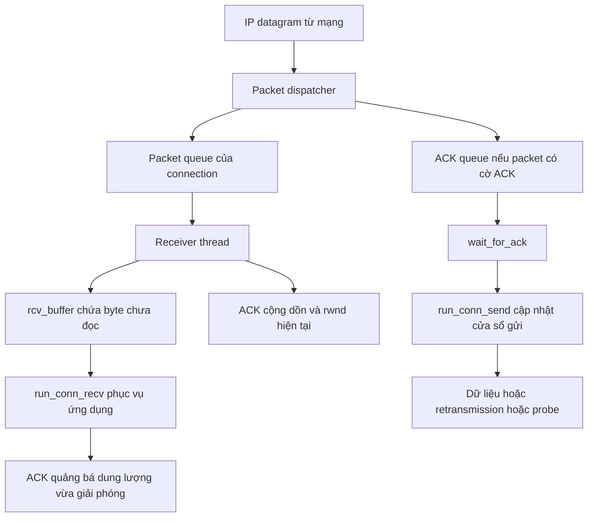
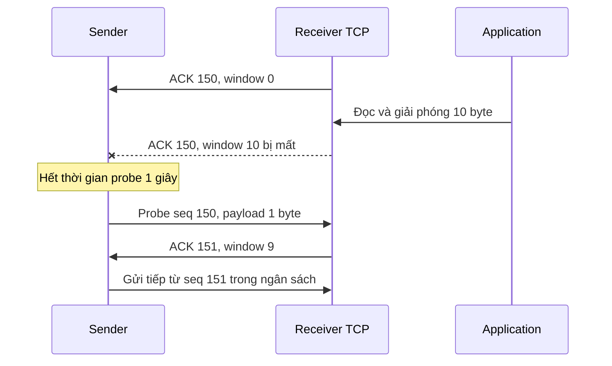

# Thiết kế và workflow Reliability, Flow Control của StreapRous

> Phạm vi: mã nguồn đến Checkpoint 3, đối chiếu trực tiếp ngày 17/11/2026. Tài liệu mô tả implementation hiện có; các giới hạn được nêu ở cuối. Reliability và Flow Control là hai nhóm chức năng cùng thuộc transport TCP của project, cùng sử dụng trạng thái connection, không phải hai tầng giao thức độc lập trên đường truyền.

## 1. Cơ sở lý thuyết và phạm vi triển khai

| Nội dung | Nguồn tham chiếu | Áp dụng trong project |
|---|---|---|
| TCP byte stream, header, sequence và ACK | Slide 77–80 | Sequence đánh số byte; ACK chỉ byte kế tiếp mong đợi |
| Ước lượng RTT và timeout | Slide 81–83 | `RttEstimator`, `EstimatedRTT + 4*DevRTT` |
| Sender, receiver, retransmission | Slide 84–88 | ACK cộng dồn, truyền lại segment cũ nhất, fast retransmit |
| Ứng dụng đọc chậm và receive buffer | Slide 90–93 | Receiver nền nhận độc lập với application read |
| Quảng bá receive window | Slide 94–95; sách mục 3.5.5 | Tính dung lượng trống theo byte, giới hạn dữ liệu chưa ACK |
| Zero-window probing | Sách mục 3.5.5, trang in 248 | Segment thăm dò chứa một byte khi window bằng 0 |
| Định hướng bài tập | Study guide, mục 2.2–2.3 | Phối hợp dispatcher, reliability, buffer và HTTP adapter |

Nguồn: [Slide Chương 3](../Chapter_3_v8.0.md), [study guide](../CO3094_streaprous_study_guide.md), [giáo trình Kurose–Ross, bản 8](../Computer%20Networking%20A%20Top-Down%20Approach,%208th%20Edition%20by%20James%20F.%20Kurose,%20Keith%20W.%20Ross-Pearson-9780136681557.pdf).

Nhóm chọn MTU 1500 byte và MSS 1460 byte với IPv4 header 20 byte, TCP header 20 byte. Header dữ liệu hiện không thêm TCP options. MSS là giới hạn payload của một segment, không phải tổng kích thước IP datagram.

Các quyết định triển khai riêng gồm: buffer dạng dictionary interval, một receiver thread cho mỗi connection, hai queue phục vụ nhận và xử lý ACK, probe cố định mỗi 1 giây, các giới hạn RTO và số lần retry. Slide không bắt buộc các cấu trúc Python hoặc giá trị cấu hình này.

## 2. Kiến trúc xử lý



`_packet_dispatcher()` là luồng đọc raw socket, định tuyến theo địa chỉ IP nguồn và cổng TCP nguồn sau khi lọc cổng đích. `_packet_queues` phục vụ receiver; packet có ACK được sao chép thêm vào `_ack_queues` để sender không tranh packet với receiver. Một packet mang cả payload và ACK có thể phục vụ cả hai hướng xử lý.

Queue có `maxsize=100`, đơn vị là packet. Nó là vùng trung chuyển trước xử lý, không phải `RcvBuffer` tính bằng byte. Khi packet queue đầy, packet bị bỏ; ACK queue đầy thì code thử bỏ phần tử cũ nhất và chèn phần tử mới. Mất ACK vẫn có thể xảy ra, và cơ chế truyền lại/thăm dò phải chịu được tình huống này.

`start_connection_receiver()` được gọi sau handshake ở cả `accept()` và `raw_connect()`. Worker chạy `_run_conn_receive_loop()` liên tục, kể cả khi ứng dụng đang xử lý HTTP hoặc chờ người dùng nhập. `run_conn_recv()` chỉ là đường đọc dữ liệu cho ứng dụng; nó không còn chịu trách nhiệm chạy vòng nhận packet.

## 3. Trạng thái connection và quy ước byte

`new_connection()` tạo buffer và bảng `unacked` riêng cho mỗi connection. Các record `conn_struct` được thay bằng `_replace()`, trong khi dictionary bên trong vẫn là đối tượng mutable.

| Trạng thái | Nghĩa trong code |
|---|---|
| `client_seq` | Sequence kế tiếp mong đợi liên tục từ peer, tương đương vai trò RCV.NXT; sau FIN hợp lệ còn bao gồm một sequence của FIN |
| `server_seq` | Sequence tiếp theo phía local dùng để gửi; tên biến giữ theo khung project, không chỉ dùng ở server |
| `last_byte_read` | Sequence của byte dữ liệu cuối đã bàn giao qua application read |
| `rcv_buffer` | `{sequence_bắt_đầu: bytes}`, chứa cả in-order unread và out-of-order unread |
| `rcv_buffer_size` | Sức chứa payload nhận, mặc định 65536 byte |
| `peer_rwnd` | Receive window mà peer quảng bá và sender đã chấp nhận |
| `send_base` | Sequence đầu chưa ACK của phía gửi |
| `next_seq_num` | Sequence ngay sau phần dữ liệu đã gửi |
| `unacked` | `{seq: (payload, sent_at, was_retx)}` để truyền lại và lấy mẫu RTT |
| `peer_window_seq`, `peer_window_ack` | Mốc SEQ/ACK của lần window update được chấp nhận |
| `pending_fin` | Biến local trong worker giữ sequence của FIN đến trước phần dữ liệu thiếu |

Không tồn tại một biến `rcv_nxt` song song với `client_seq`. Khởi tạo `last_byte_read = client_seq - 1` theo modulo 2^32: chưa có byte dữ liệu nào của luồng mới được ứng dụng đọc.

`seq_diff(a,b)` tính hiệu modulo 2^32 dưới dạng số có dấu. Các phép so sánh khoảng sequence cần giả định khoảng đang xét nhỏ hơn 2^31; code từ chối một payload gửi có độ dài từ 2^31 trở lên và capacity buffer từ 2^31 trở lên. Không nên dùng quan hệ lớn/nhỏ Python thông thường để so sánh sequence khi đi qua mốc 0.

## 4. Workflow gửi dữ liệu và Reliability phía sender

### 4.1. Gửi theo ngân sách

`run_conn_send(s, conn_info, payload)` lấy trạng thái mới nhất, trả 0 nếu payload rỗng và từ chối bắt đầu khi `session.unacked` còn dữ liệu. Trong một lần gọi, code thiết lập:

```text
start = server_seq
send_base = next_seq_num = start
target = start + len(payload)                 # modulo 2^32
in_flight = seq_diff(next_seq_num, send_base)
budget = max(0, peer_rwnd - in_flight)
chunk_length <= min(MSS, budget, payload_remaining)
```

Trước từng segment mới, sender đọc lại connection và tính ngân sách. `send_tcp_data_segment()` tạo TCP segment PSH+ACK, gắn ACK của hướng nhận bằng `session.client_seq`, và window bằng receive window của chính local. Window trong gói gửi là sức nhận của local; `peer_rwnd` mới là số dùng để hạn chế hướng gửi.

Sau khi gửi, segment được thêm vào `unacked`, `next_seq_num` và `server_seq` tiến theo số byte payload. Khi hết ngân sách hoặc đã gửi hết payload, sender gọi `wait_for_ack(..., return_on_update=True)`. Sau ACK/window update, vòng ngoài cập nhật `send_base` và thử gửi tiếp. Hàm trả độ dài payload khi toàn bộ dữ liệu được ACK; lỗi trong vòng gửi được log và trả `-1`.

### 4.2. Xử lý ACK

`wait_for_ack()` đọc ACK queue, kiểm tra checksum, cặp IP/cổng, cờ ACK và loại packet có SYN/RST/FIN. ACK được chấp nhận trong phạm vi từ `start` đến `target` của lượt chờ hiện tại; `target` có thể tăng thêm một khi gửi probe bằng byte mới.

ACK number là byte tiếp theo receiver mong đợi. Vì vậy `last_byte_acked = ACK - 1`. Với ACK tiến thêm, code xóa toàn bộ segment được xác nhận khỏi `unacked`. Nếu ACK chỉ bao phủ một phần segment, code giữ phần đuôi chưa ACK dưới key bằng ACK number.

Ví dụ, đang giữ `[100,119]`, nhận ACK 110: loại `[100,109]`, giữ `[110,119]`. ACK cộng dồn có thể giải phóng nhiều segment trong cùng một lượt xử lý; không cần ACK riêng cho từng packet.

Với ACK không tiến nhưng window thay đổi, sender xử lý như window update và có thể quay về vòng gửi. Với ACK thuần trùng số xác nhận, còn dữ liệu chưa ACK và lượt chờ không ở zero window, code tăng `dup_count`; đúng ba duplicate ACK kích hoạt truyền lại segment cũ nhất.

### 4.3. RTT, RTO và retransmission

`RttEstimator` được tạo mới trong mỗi lần gọi `run_conn_send()`. Mẫu RTT được lấy từ segment đã ACK hoàn toàn và chưa từng retransmit. Code tránh lấy mẫu từ segment đã truyền lại để hạn chế nhập nhằng ACK của bản gửi nào (nguyên tắc Karn).

```text
Mẫu đầu: EstimatedRTT = SampleRTT; DevRTT = SampleRTT / 2
Mẫu sau:
DevRTT = (1 - 0.25) * DevRTT + 0.25 * abs(SampleRTT - EstimatedRTT)
EstimatedRTT = (1 - 0.125) * EstimatedRTT + 0.125 * SampleRTT
RTO = clamp(EstimatedRTT + 4 * DevRTT, 0.2, 10.0) giây
```

Code cập nhật DevRTT trước EstimatedRTT nên độ lệch dùng EstimatedRTT cũ. RTO ban đầu 1 giây, giới hạn 0.2–10 giây và `MAX_RETRIES=5` là cấu hình implementation.

Khi deadline hết hạn và có dữ liệu chưa ACK, `retransmit_oldest()` chọn segment có sequence sớm nhất tương đối với `start`, gửi lại toàn bộ phần payload còn giữ, đánh dấu `was_retx=True`. Sau RTO timeout, thời gian chờ được nhân đôi, giới hạn 10 giây. Hết số lượt retry trong lượt chờ sẽ báo lỗi. Fast retransmit cũng gửi lại segment cũ nhất nhưng không dùng nhánh nhân đôi RTO này.

## 5. Workflow nhận và quản lý receive buffer

### 5.1. Kiểm tra và ghép byte

Receiver lấy packet từ queue, kiểm tra checksum, TCP header và cổng, xử lý RST hoặc các cờ điều khiển liên quan. Với payload hợp lệ, receiver lấy trạng thái connection dưới `connections_lock`, rồi đặt:

```text
window_start = last_byte_read + 1
khoảng lưu được = [window_start, window_start + rcv_buffer_size)
```

Đây là khoảng nửa mở theo modulo 2^32. Ví dụ ứng dụng đọc đến byte 99, capacity 50 thì byte có thể lưu là 100 đến 149, bao gồm cả hai đầu. Công thức viết bằng hai đầu đóng là `[last_byte_read+1, last_byte_read+capacity]`.

`merge_interval_into_rcv_buffer()` chuyển các interval thành các ô byte theo offset, bỏ byte ngoài khoảng, thêm byte mới bằng `setdefault()` và ghép lại các đoạn liên tục. Byte đã lưu được giữ nguyên nếu payload mới chồng lấn; các bản trùng không tăng occupancy. Cách thực hiện ưu tiên sự rõ ràng, có chi phí tạo dictionary theo từng byte và sắp xếp offset.

### 5.2. Tiến ACK cộng dồn

Sau khi lưu, worker bắt đầu tại `client_seq` và tìm interval bao phủ vị trí đó. Nếu có, mốc mong đợi tiến đến cuối interval; tiếp tục cho đến gap đầu tiên. Sau đó gửi ACK chứa mốc mới và receive window hiện tại.

- Segment đúng thứ tự có thể làm ACK tiến thêm.
- Segment ngoài thứ tự được lưu nhưng ACK vẫn chỉ byte thiếu đầu tiên.
- Segment trùng không làm tăng số byte lưu; receiver vẫn có thể trả ACK hiện tại.
- Khi segment lấp gap đến, ACK có thể tiến qua cả các đoạn đã nhận trước đó.

Code dùng chiến lược ACK ngay cho payload/FIN đang xử lý; không triển khai timer delayed ACK đầy đủ theo mọi tình huống minh họa ở slide 85. Buffering ngoài thứ tự và truyền lại có chọn segment không đồng nghĩa implementation là giao thức Selective Repeat nguyên mẫu; giao thức vẫn sử dụng TCP cumulative ACK, chưa có SACK option.

### 5.3. Occupancy và rwnd

```text
occupied = sum(len(data) for data in rcv_buffer.values())
rwnd = min(rcv_buffer_size - occupied, 65535)
```

Hàm `get_current_rwnd()` báo lỗi nếu occupancy vượt capacity. Dictionary cần giữ các interval không trùng lấn để phép cộng không đếm hai lần. Chỉ cộng tổng dictionary, không cộng thêm một khoảng in-order unread vì các byte đó đã nằm trong dictionary.

Sách mục 3.5.5 trình bày `RcvBuffer - (LastByteRcvd - LastByteRead)` trong mô hình đơn giản bỏ dữ liệu ngoài thứ tự. Đếm byte chưa đọc duy nhất là cách nhóm áp dụng nguyên tắc dung lượng trống cho thiết kế giữ out-of-order, không phải công thức trích nguyên văn của sách. Không đồng nhất `LastByteRcvd` với byte cao nhất đã đến rồi đồng thời dùng nó như cuối prefix liên tục.

Ví dụ capacity 50, đã đọc đến 99, nhận `[100,109]` và `[120,129]`: occupied 20, rwnd 30, ACK 110. Gap `[110,119]` không chiếm byte lưu; ACK vẫn không vượt gap. Khi nhận thêm `[110,119]`, occupied 30, rwnd 20, ACK 130.

### 5.4. Application read và window update

`run_conn_recv()` gọi `read_contiguous_buffer()`. Hàm này chỉ lấy byte từ `last_byte_read+1` đến trước `client_seq`, có thể giới hạn bởi `max_bytes`. Đọc một phần interval sẽ giữ lại phần đuôi. Chỉ khi lấy byte cho ứng dụng, `last_byte_read` mới tiến và occupancy mới giảm.

Khi có dữ liệu trả về, code gửi ACK thuần với `ack_seq=client_seq` và `window=get_current_rwnd(session)`. Nếu receiver không nhận thêm dữ liệu thì ACK number có thể giữ nguyên, nhưng window lớn hơn; đó là window update.

Khi chưa có byte liên tục, ứng dụng chờ Event với lượt kiểm tra 0.1 giây. Receiver vẫn tiếp tục nhận dữ liệu. `max_bytes=0` trả rỗng ngay; giá trị âm bị từ chối. Dữ liệu trả về là byte stream khả dụng, không bảo toàn ranh giới packet hoặc bảo đảm một lần đọc chứa đủ HTTP message.

## 6. Zero-window recovery và quan hệ với Reliability

### 6.1. Chu kỳ thăm dò

Khi `peer_rwnd=0`, sender ngừng phát dữ liệu mới thông thường. `wait_for_ack()` dùng `time.monotonic()` để đặt `probe_deadline`, mỗi 1 giây gửi một byte để kích thích phản hồi ACK/window. Đây là lựa chọn cố định của nhóm; sách trang 248 nêu thăm dò một byte nhưng không ấn định chu kỳ này. Không mô tả chính sách này là persist timer đầy đủ theo RFC với exponential backoff.

| Trạng thái phía gửi | Byte và sequence dùng làm probe | Cập nhật |
|---|---|---|
| `unacked` còn dữ liệu | Byte đầu của segment chưa ACK sớm nhất | Giữ sequence đã dùng; đánh dấu segment đã retransmit |
| `unacked` rỗng, còn payload chờ gửi | Byte tiếp theo trong `probe_data`, sequence bằng `target` của lượt chờ | Thêm một byte vào `unacked`; tăng target, `next_seq_num`, `server_seq` một đơn vị |
| Không còn payload để probe | Không tạo byte giả | Không tăng sequence |

Khi byte probe đã được gửi nhưng chưa ACK, những lần thăm dò sau dùng lại byte chưa ACK đó. Nhánh zero window không tăng `retries` của timeout mất dữ liệu, không chạy nhánh fast retransmit cho lượt chờ đang nhận diện zero window. Nó kiểm tra connection đóng/reset/lỗi với chu kỳ chờ tối đa 0.2 giây.

### 6.2. Phản hồi của receiver

Receiver dùng đường nhận dữ liệu thông thường cho probe. Khi buffer đầy, byte mới ngoài phần có thể lưu không được thêm; ACK phản hồi vẫn mang byte mong đợi và window hiện tại. Khi ứng dụng giải phóng đủ chỗ, byte có thể được nhận và ACK tiến tương ứng. Byte trùng được khử trùng bởi quy tắc interval.



Nếu ACK phản hồi là 150 với window 10, sender chưa được coi byte 150 là đã nhận. Phần đó vẫn nằm trong `unacked`; Reliability sẽ truyền lại khi cần. Code hiện không có nhánh riêng bắt buộc truyền lại byte probe ngay khi cửa sổ mở: sender có thể gửi thêm byte mới trong ngân sách, còn byte chưa ACK được xử lý bởi retransmission. Nếu ACK là 151 thì byte 150 đã được xác nhận, không được thêm lần nữa vào dữ liệu ứng dụng.

### 6.3. Chấp nhận window update

Sender kiểm tra window sau khi ACK vượt qua bộ lọc hợp lệ. `peer_window_seq` và `peer_window_ack` được dùng với điều kiện:

```text
Chưa có mốc cập nhật trước đó
OR pkt_seq mới hơn peer_window_seq
OR pkt_seq bằng peer_window_seq AND pkt_ack không cũ hơn peer_window_ack
```

Đây là bookkeeping bổ sung theo quy tắc thứ tự SEQ/ACK của TCP, không phải công thức có sẵn trên slide 90–95. Hai ACK có cùng cả SEQ và ACK nhưng window khác nhau không có số phiên bản riêng trong thiết kế hiện tại; không được tuyên bố luôn phân biệt được bản cũ/mới của mọi window update.

Trong luồng đã thiết lập, receiver nền chỉ cập nhật hoạt động nhận; `wait_for_ack()` là nơi chấp nhận cập nhật `peer_rwnd`. Giá trị ban đầu lấy từ handshake. ACK queue giữ packet đến khi sender xử lý; vì vậy cập nhật peer window không nhất thiết xảy ra ngay khi packet tới dispatcher.

## 7. FIN, lỗi và đồng bộ giữa các luồng

FIN có thứ tự trong sequence space và chiếm một số sequence. Worker giữ FIN đến sớm trong `pending_fin`, đợi prefix trước FIN đầy đủ rồi chuyển sang `CLOSE_WAIT` và ACK cả FIN. Payload kèm FIN được xét trước khi hoàn thành nhận FIN. Byte đã buffer sau mốc FIN được cắt bỏ khi chấp nhận FIN đó.

Ứng dụng vẫn được đọc dữ liệu trước FIN. `read_contiguous_buffer()` trừ một sequence của FIN khỏi điểm kết thúc dữ liệu khi state là `CLOSE_WAIT`; sau khi đọc hết mới trả EOF. FIN không trở thành byte payload.

RST đặt trạng thái `RESET` và cho worker kết thúc. Nhánh lỗi worker log lỗi, đặt `ERROR` nếu vẫn là phiên tương ứng, đánh thức ứng dụng; `run_conn_recv()` báo `ConnectionError` ở trạng thái này. Worker kiểm tra session còn tồn tại và Event còn thuộc phiên của mình để thoát khi connection bị xóa hoặc thay thế. Cơ chế này hỗ trợ phân biệt worker cũ và phiên mới cùng key; không thay thế đầy đủ cơ chế xác thực packet cũ của TCP.

`connections_lock` bảo vệ các đoạn đọc/thay record và thao tác buffer trong các luồng gửi/nhận chính. `_receive_workers_lock` bảo vệ bảng worker/Event, lock dispatcher bảo vệ bảng queue. Cập nhật record cần dùng phiên bản mới nhất trong cùng khối khóa; receiver không gán `server_seq` từ ACK nhận được. Các local variable của sender và dictionary mutable cần được xét riêng khi đánh giá concurrency; việc có lock không tự chứng minh mọi liên kết trạng thái là nguyên tử.

`close_connection()` hiện gửi FIN rồi xóa session, đánh thức bên đọc và dọn queue. `close_all_connections()` xóa session, queue và đánh thức Event. Chưa có quy trình đóng TCP đầy đủ qua FIN_WAIT_1, FIN_WAIT_2 và TIME_WAIT.

## 8. Ánh xạ thiết kế sang code

Các số dòng dưới đây tương ứng snapshot đọc khi viết tài liệu; nên tìm theo tên hàm khi source thay đổi.

| Chức năng | File, hàm | Dòng bắt đầu |
|---|---|---:|
| Khởi tạo state riêng từng connection | `streaprous_raw_connection.py`, `new_connection()` | 64 |
| Sequence modulo và phân loại helper | `seq_diff()`, `classify_segment()` | 115, 120 |
| Ước lượng timeout | `RttEstimator` | 140 |
| TCP checksum | `checksum()`, `verify_tcp_checksum()` | 210, 226 |
| TCP ACK/control header | `build_tcp_packet()` | 241 |
| Receive window | `get_current_rwnd()` | 327 |
| Ghép interval unread | `merge_interval_into_rcv_buffer()` | 338 |
| Đọc byte liên tục | `read_contiguous_buffer()` | 373 |
| Đóng gói segment dữ liệu | `send_tcp_data_segment()` | 396 |
| Khởi chạy receiver | `start_connection_receiver()` | 931 |
| Application read | `run_conn_recv()` | 953 |
| Receiver transport | `_run_conn_receive_loop()` | 1009 |
| ACK, retransmit, zero-window probe | `wait_for_ack()` | 1185 |
| Vòng gửi theo ngân sách byte | `run_conn_send()` | 1384 |
| Dispatcher và queue | `streaprous_packet_dispatcher.py`, `_packet_dispatcher()`, `get_packet_queue()`, `get_ack_queue()` | Tìm theo tên hàm |
| HTTP application read | `daemon/httpadapter.py`, `handle_client_raw()` | Gọi `run_conn_recv()` |
| Mô phỏng | `tests/flow_control_simulation.py` | `Wire`, `setup()`, `run()` |

Mã nguồn: [raw connection](../streaprous_socket/streaprous_raw_connection.py), [dispatcher](../streaprous_socket/streaprous_packet_dispatcher.py), [HTTP adapter](../daemon/httpadapter.py), [client](../client.py).

`classify_segment()` và `split_into_segments()` là các helper đang có, nhưng workflow nhận chính dùng interval merge/reassembly và workflow gửi chính cắt payload trực tiếp trong `run_conn_send()`. Không mô tả hai helper này như bước bắt buộc đang được gọi trong luồng chính.

## 9. Kiểm chứng và cách diễn giải kết quả

[Test mô phỏng](../tests/flow_control_simulation.py) thiết lập các session đã ESTABLISHED và chuyển packet bằng `Wire.sendto()`, không chạy handshake hoặc raw network. Packet có ACK được đưa vào cả hai queue để mô phỏng phân phối. Test đặt `m.MSS=10` trong process mô phỏng, capacity nhỏ và đọc từng 3 byte nhằm dễ quan sát biên; MSS mặc định của thư viện vẫn là 1460.

| Nhóm ca trong file | Điều kiện được kiểm tra |
|---|---|
| Capacity 8, bỏ window update | Truyền đủ payload khi ứng dụng đọc chậm và mất một thông báo window |
| Capacity 40, bỏ segment dữ liệu | Phục hồi dữ liệu thiếu và ghép đúng thứ tự |
| Window ban đầu 0 | Packet dữ liệu đầu là probe một byte, sau đó truyền đủ |
| Bỏ thông báo mở window và probe đầu | Có ít nhất hai probe, khoảng cách hai probe đầu ít nhất 0.9 giây, nhận đủ payload |
| Hai connection đồng thời | Connection zero window còn chờ trong khi connection khác truyền xong; đóng toàn bộ giúp sender thoát |

Các lượt truyền chính so sánh payload nhận với 70 byte gốc, kiểm tra sender trả đúng số byte, kiểm tra occupancy tại các lần lấy mẫu không vượt capacity. `Wire` kiểm tra ngân sách cho packet mới dài hơn một byte khi sequence trùng `next_seq_num`. Điều này không phải kiểm chứng riêng mọi packet một byte hoặc mọi thời điểm occupancy.

Có bốn lượt `run()` cộng một kịch bản nhiều connection. Danh sách `[66, 53, 70, 67]` từng được báo cáo là số frame quan sát của bốn lượt, không phải số assertion hay bằng chứng mọi nhánh TCP đều được kiểm chứng. Timing phụ thuộc scheduling nên không dùng số frame chính xác làm tiêu chí giao thức.

Lệnh chạy từ thư mục gốc:

```bash
PYTHONDONTWRITEBYTECODE=1 PYTHONPATH=. python3 tests/flow_control_simulation.py
```

Tài liệu này được viết bằng đọc source và đối chiếu tài liệu; không chạy lại test trong lượt viết tài liệu. Kết quả PASS đã được báo cáo ở lượt triển khai trước. Các script kiểm tra độc lập trong báo cáo kiểm toán là kết quả do người kiểm toán cung cấp, không được xem như đã tái thực thi ở đây. Chưa có bằng chứng trong file test này cho raw socket thực tế, handshake, mọi trường hợp overlap, FIN, ba duplicate ACK hoặc sequence wraparound toàn luồng.

## 10. Giới hạn của implementation cần ghi trong báo cáo

1. **Congestion Control chưa tham gia ngân sách gửi.** `cwnd`, `ssthresh`, `ca_state` được khởi tạo nhưng `budget` hiện chỉ dựa trên `peer_rwnd`. Không tuyên bố đã có ngân sách `min(cwnd, rwnd)` hoặc TCP Reno đầy đủ.
2. **Timer và bộ đếm có phạm vi lượt chờ.** `wait_for_ack()` khởi tạo lại `retries`, `dup_count`, deadline mỗi lần gọi; sender thường quay về vòng ngoài ngay khi có ACK tiến thêm/window update. RTO gắn với các lượt chờ segment cũ nhất, chưa phải timer connection tồn tại liên tục. `RttEstimator` cũng không được giữ xuyên suốt nhiều lần `run_conn_send()`.
3. **Một số lựa chọn đơn giản hóa khác giáo trình minh họa.** ACK được gửi ngay, probe cố định 1 giây; receive buffer chứa out-of-order. Phải phân biệt các lựa chọn này với nội dung nguồn, không gọi mọi chi tiết implementation là quy định từ slide.
4. **Handshake/control còn default window.** Một số lời gọi `build_tcp_packet()` trong handshake và đóng local dùng default 65535. Với capacity mặc định và buffer rỗng, giá trị này khớp giới hạn trường 16-bit; với cấu hình buffer khác, chưa bảo đảm quảng bá đúng capacity. Không tuyên bố mọi packet đều dùng window động.
5. **Teardown và timeout dọn session còn đơn giản.** Đóng local chưa có FIN_WAIT/TIME_WAIT; `clean_expired_connections()` có thể xóa connection do inactivity, độc lập với chế độ chờ zero window. Không tuyên bố giữ connection vô hạn trong mọi cấu hình.
6. **Phạm vi đa connection có giới hạn.** Queue và state tách theo peer key, nhưng dispatcher là singleton toàn cục: `start_packet_dispatcher()` trả về nếu đang chạy. Chưa phải kiến trúc hỗ trợ tùy ý nhiều raw socket/listen port cùng process. Cũng không có khóa riêng để bảo đảm hai application thread gọi gửi đồng thời trên cùng connection là an toàn.
7. **Hiệu năng và tài nguyên.** Buffer merge dựng ô theo từng byte, application read tách phần đuôi qua từng byte; tổng RAM gồm cả queue, dictionary và payload gửi, không chỉ `rcv_buffer_size`. Sức chứa ở đây giới hạn số byte payload được giữ trong receive buffer.
8. **Kết luận kiểm toán cần có phạm vi.** Có đường xử lý và test mô phỏng đạt không đồng nghĩa mọi race, packet hỏng, window update cũ, wraparound và interoperation TCP đều được chứng minh. Quy tắc freshness với SEQ/ACK bằng nhau và snapshot rwnd/ACK gửi ngoài lock vẫn cần kiểm thử thêm khi đánh giá mạng thực tế.

Các giới hạn trên được mô tả từ code hiện có, không được tự động coi là đã sửa chỉ vì báo cáo kiểm toán trước đánh giá Checkpoint 3 đạt. Tài liệu phân biệt rõ hành vi đã triển khai, lựa chọn của nhóm và phạm vi kiểm chứng để sử dụng trong báo cáo học phần.
